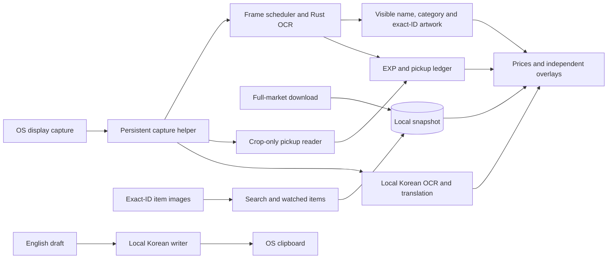

# Lupin architecture

Lupin provides market references, EXP/meso tracking, local Korean translation and a searchable Classic World database for MapleStory Classic World.

## Observation boundary

Game observations come only from ordinary OS-shared screen pixels. No game-process discovery, handles, memory, files, packets, rendering/input hooks or game input are used. The annotation canvas is an independent input-transparent window. OS cursor coordinates position inventory cards. Windows shortcuts use RegisterHotKey; Wayland uses the GlobalShortcuts portal and X11 uses passive grabs for the chosen chords.

Screenshots, chat and drafts remain local. Market downloads contain public market data; image downloads use exact catalog IDs. The Korean writer copies validated text to the OS clipboard only after an explicit action. It never pastes, sends keys or focuses a game field.

## Processes and data flow

The main Qt process owns settings, layouts, market state and session accounting. Capture and annotations use separate helpers. The Rust reader accepts only local RGBA/PNG input through its own JSON stdin/stdout. Translation workers communicate over bounded local pipes and load their verified models on demand. All portal callbacks enter the Qt GUI thread through signals.

## Capture and recognition

Linux retains its approved PipeWire/portal sharing session. SIGUSR1 hands the capture helper to a replacement UI without another chooser. Normal Quit ends sharing. The explicit KDE screenshot fallback remains available for troubleshooting.

Windows captures the selected OS display with `QScreen.grabWindow(0)`, using desktop GDI rather than Direct3D desktop duplication. It never obtains a game window handle. The dropdown contains real displays; geometry changes update the selected display. Capture runs at most ten times per second, pauses without demand, and skips work while its local output is busy.

Frame dimensions and local buffers are bounded. The client drains packets promptly and retains one newest completed frame; the display interval applies to delivery, not socket reads. Superseded frames are discarded. Pause, stop and display changes clear pending delivery.

`SubmittedRequest` in `reader_request.py` captures each job's mode, implicitly
shared source image, pointer, crop/analysis coordinates, generation, relevant
shop or tracking epoch and timeout deadline. Result handling uses that submitted
context rather than mutable current-frame flags. EXP-only work does not consume
an unread shop sequence. `PixelReader.request_rescan()` requests newest-frame
work without changing the deadline of an already running request.

The visible bottom status bar and static frame evidence locate Classic World. FPS and movable minimap placement are not anchors. Shop/tooltip pixel fingerprints avoid repeated OCR and preserve proven identities through modest movement and occlusion. Equipment names include gender/stat/tier evidence; ambiguous IDs remain unresolved.

Only a missing, uncovered shop price triggers a retry. A cropped shop passes through the unchanged strict upstream reader at two resamplings. Recovery requires agreement on exact name, row position, quantity and the complete meso amount. Existing prices are never overwritten. An eight-patch pixel cache also remembers failures. The pinned Minerva revision and OCR model are unchanged; the worker uses two OCR threads.

`reader/src/shop_panes.rs` keeps the separate sold-items ledger out of listing
selection. Rejection requires its normalized totals heading and native three-line
summary/grid geometry, rather than a global item-name blacklist. It masks only
the proven ledger in a copied shop-selection frame, with at most two retries;
the original pixels remain available to inventory and generic descriptions.

An empty detected blue table is not sufficient to suppress generic inventory tooltips: NPC buy/sell lists share that palette. Such rectangles remain available for fingerprints but do not establish pointer-in-player-shop context without rows. The next hover read uses the full frame, allowing an NPC sell-list item and its comparison panel through the ordinary item-name/catalog rules. Closing the reader marks it paused before draining its process, so a queued scan cannot access deleted Qt children.

## One full-market cache

`PriceService` loads the Classic World regular/cash catalog and manages a single `SnapshotStore`/`SnapshotUpdater`. There is no individual-price provider, per-item HTTP queue or provider-ID index.

Item identification precedes market lookup. `item_identity.py` keeps an exact ID
local to the currently observed row or inventory source; market presence cannot
choose between distinct same-name items or create a global name preference.
Catalog entries retain equipment subcategories and gender. A bounded comparison
of cached exact-ID candidate images may resolve a shop icon only when every
competitor is available and clearly excluded. Shared, covered, missing or weak
artwork remains ambiguous. At most eight candidates and eight million sampled
pixel comparisons are considered; the GUI keeps a bounded image-signature cache.
Thumbnail demand uses the existing image queue and never adds a price request.

Bounded row-pixel proofs validate the submitted name, asking price and icon
against the newest captured frame. Cursor and recognized overlay/description
pixels cannot establish native changes. Lost containers or contradictory source
pixels retire live offers and request a new reading; they do not by themselves
establish scrolling. Recovery of a covered asking price also requires the full
source proof, so an unchanged name band cannot restore a different same-name
item's offer. Recovery caches remain separate from current offers.

Hypothetical native scroll colors narrow actual scroll candidates only. Narrow
quote typography/spacing normalization retains item words and variant roles.
Exact-ID gender suffixes may corroborate known equipment metadata; a combined
variant label such as “Blue or Red” does not establish either individual variant.
`SnapshotStore.lookup` distinguishes priced, no-sales, missing, variant-mismatch
and unit-mismatch states. The shared cards and overlays preserve those reasons
instead of representing every rejection as absent sales or indefinite work.
`market_lookup.py` shares the quote/reason result across the service and views.
An explicit unique search result, including a numeric item ID, is selected from
the catalog independently of snapshot coverage or age. Shared names remain
local ambiguity; the former provider-selection signals, cache and resolver are
removed. The catalog ID index serves direct selection and contextual ID checks.

On every launch, saved data loads immediately and one asynchronous full-market download starts. Later downloads use the earlier of the selected 5/15/30/60-minute interval and the source publication's one-hour expiry. Changing the interval uses that same deadline. Overlapping refreshes coalesce. Overlay, search and watched-item prices are local snapshot reads; typing, selecting, hovering and watching never initiate individual price requests.

A short-lived native `lupin-market-fetch` helper reads the ordinary public market page using system web views: WebKitGTK on Linux and the shared production WebView2 runtime on Windows. It uses an offscreen/invisible window owned by the helper, never a game window. Linux uses an ephemeral context; Windows uses an app-owned data directory and disables OS-account single sign-on. Website permission requests and new windows are denied. No personal browser, installed browser discovery, DevTools socket or resident service is involved. Well-formed source rows with different listing/catalog IDs are excluded as unverified aliases; they never map prices to either ID. Malformed identities, duplicates, wrong worlds and empty exact generations still reject the update.

`SnapshotFetcher` bounds UTF-8 stdout to 8 MiB, retains only bounded diagnostic stderr, accepts one JSON object after a successful helper exit and enforces a deadline. Stop/cancellation discards pending results; refreshes coalesce while a previous helper shuts down. Only the subprocess created by Lupin is terminated. The Windows helper's private job controls its own descendants so cancellation cannot leave its renderer running. Full generation validation still occurs in `SnapshotStore` before replacement.

A complete generation is validated before an atomic SQLite replacement. Checks require Classic World, live list schema, exact IDs/names, clean equipment and item/set units. Failed/invalid refreshes retain the last-good data and its original ages. A transient startup failure gets one retry after 15 seconds, then uses bounded 5/15/60-minute backoff. Missing runtimes and invalid documents do not trigger the startup retry. Successful refreshes never inherit a failure cooldown. `market-last-error.json` retains only the failure kind, exit code, time and up to twelve fixed helper stage/error-code pairs, never page bodies or user text. Connection details shows the current process's retained failure.

Check time, publication time and latest observed-sale time are distinct. Validity ends at the earlier of check time plus the selected interval and publication time plus one hour. An expired publication returned successfully uses a separate bounded 60/300/900-second retry sequence, capped at the selected interval; it cannot trigger a fetch loop or acquire a false publication age. Old/missing observations, thin samples and uncertain units cannot earn deal colors. Rechecking an unchanged publication cannot make its publication or observed sales newer. Missing items stay unpriced. Fresh-generation signals update existing rows even when their numeric price is unchanged, without new OCR, pointer movement or structural animation.

Overlay annotations show the source's latest observed-sale age rather than repeating the snapshot check age. Stale/refresh warnings remain explicit. The larger item panel shows the source's latest observed-sale time. The full list does not supply a verified individual transaction amount; the market median is never presented as the latest sale price.

## Prices and watched items

`PriceObservations` in `price_observations.py` owns accepted shop rows, bounded
recovery caches, identity proofs and shop-description transitions. It has no
widgets, market requests or capture scheduling. `LensWindow` renders its state
and asks the reader for work through the rescan API. Tooltip associations are
constructed once by capture and revalidated in the UI; direct/legacy result
paths retain their bounded decoder. One row source proof supports exact and
verified-selection checks, while the separate icon-result cache retains its
own image signature.

`ShopBrowsing` provides a separate 1.5-second monotonic shop-priority window after
a verified viewport change. Exposed native scrollbar movement or changed fresh
canonical row identities with changed native name pixels advances its epoch.
Annotation/tooltip pixels, raw OCR corrections, quote changes and shop dragging
cannot extend the deadline. The capture worker tags each shop read with that
epoch; old results cannot restore prior-page identities or asking prices.
Independent EXP and pickup replies are not discarded for a shop-only change.

During browsing, current verified shop labels remain opaque over the native
description and Prices keeps its shop cards. The description itself is never
changed or hidden. Pending/old-page labels and description clones, including
retiring clones, are removed immediately. Covered new rows remain unknown.
Expiry wakes presentation independently of new frames and revalidates the current
hover before restoring ordinary dimming and description focus. Manual search,
watched selection and inventory hover outside the shop retain their precedence.
This policy is independent of GUI history grace and same-page offer retention.

`annotation_geometry.py` calculates description and protected-region placement
and drawing bounds. The independent annotation process retains replacement,
opacity, animation and painting. Current tracking annotations use the shared
`tracking` kind; retired `experience` drawing branches are removed.

Selected shop bands can have a different brightness from normal rows. Inside an independently detected shop, the reader measures the blue and orange palettes, validates a single broad selected band, and adjusts only its background pixels in a copy. It reuses the primary strict OCR engine and merges only complete, noncontradicting reads from that band. An eight-entry cache includes current list pixels and coordinates, so price changes and occluders cannot inherit prior amounts. The original frame still drives tooltips and occlusion.

The locator can retain a proven footer span while an item description covers its white rim, provided the independent LV template and OS caption still verify the same coordinates. Cold acquisition additionally permits one independently framed, dark native description with a cyan title marker across the rim, requiring repeated real rim endpoints and a separately verified caption. Arbitrary fragmented rims remain invalid. Losing those anchors still removes the game area. Title retries keep the public description bounds but omit the verified leading marker from the glyph crop; decorative pixels must not become OCR punctuation. Exact catalog rules remain unchanged and no nearest-name fallback is used. Shop selection/unreadable names retain references under verified page guards, without an assumed current listing amount. A listing returns without another OCR pass only when the entire previously read row pixels and page guards match exactly. Occlusion alpha uses the recognized current description rectangle only; late OCR replies cannot restore a description absent from the latest frame. The old covered-row opacity fallback is removed. Labels use page/item/list-local slot identities, independent of raw OCR row order or absolute shop position. A verified covered row may preserve its last-confirmed display amount for at most thirty seconds, separately from the current-offer field. That presentation is bound to the same quote generation and verified page/slot/item; changes or expiry discard its deal appearance. Guard exceptions cover only the actual native tooltip pixels and require remaining visible proof. Repeated clear commands share a single 200 ms occlusion-release deadline, allowing a single 150 ms proof miss without an opacity reversal.

Paired frame strokes alone do not establish a description: bright shop panes have similar borders. Description geometry also requires a dark native interior, excluding Lupin's own annotation rectangles from both body evidence and name anchors. The same proof validates retained rectangles against current frames. Omitting an occlusion from a new annotation clears the previous value. This prevents our dark labels from manufacturing evidence for the pane behind them and repeatedly dimming themselves.

Clicked item-link descriptions may be located beyond the pointer's usual search area. The Rust reader reuses its existing name/bullet recognizer over bounded analysis regions without changing the real cursor or sending input. The GUI requires a catalog match and a visible anchored native description panel before accepting those results. A structurally verified pair of native frame edges permits a local header-only contrast adjustment when chat shows through the translucent fill or upgraded equipment has colored title ink. The cyan marker and its antialiased fringe stay intact, bright foreign occluders are preserved, and the original frame still drives all shop readings and geometry. The same paired-edge proof keeps adjacent comparison panels separate even when their purple hue is lost. A unique equipment name may drop its visible upgrade count for the existing unscrolled reference; exact catalog names retain priority. Cash descriptions with no cyan marker use a separate bounded header reader. It requires paired vertical frame edges and the horizontal top rim, then reads only centered title lines. Complete descenders are retained; up to eight exact header masks cache successful/failed reads. It never searches arbitrary scene text or substitutes a guessed catalog name. Such cards remain beside the description. Small-font I/l and g/q variants and ellipsis punctuation are accepted only for unique catalog candidates; shorter shared Ink-and-Wash prefixes remain ambiguous.

Search controls sit above one shared content area. Selected-item and on-screen/ready views use the same origin. A missing on-screen item gets a 2 second GUI grace period before its card retires to history; this does not extend an overlay's lifetime or verify an old offer. A replacement item can take over the active area without a ready/history detour. Active-card changes and recent-row movement have independent transitions, so history is not faded through a blank frame with the active card. Empty status rows are hidden. New market generations synchronize retained price cards even while capture is paused. Search is part of Prices and takes space priority while active. Clearing it animates shop cards back into view. Shop cards retain their widget instances and layout positions during quote/age updates. Adding a hovered item does not change shop-card identities. Search, shop and inventory cards share an exact-ID watch star and thumbnails. The removed Details expander has no runtime path.

Watched items start collapsed. Expanding shows a compact list with thumbnails and cached references, capped at three visible rows. Its contents stay at a stable full height while a clipping viewport slides, avoiding repeated list reflow. Header/empty-space clicks toggle the panel; items, stars and the scrollbar retain their actions. Rounded selection covers the full row.

Only an item click opens its larger card and takes space priority. Expanding alone retains the normal item/ready view. Deselecting clears that card while retaining the watched view. Collapsing clears the selection and returns to shop cards. Watching/unwatching changes saved exact IDs, not market demand. In-game watched labels shimmer twice inside a steady border and retain a star. Reduced motion uses a steady marker.

Thumbnail downloads share a two-request queue, bounded memory/disk caches and negative caching. Cached images are used immediately without waiting for a network signal. No fetched thumbnails ship.

## Tracking and translation

Tracking starts stopped. Explicit Start enables EXP sampling once a second and a bounded bottom-right pickup-log crop at up to five samples a second. Pickup OCR uses a separate invocation of the same native binary, restricted to one thread and one in-flight crop; it shares the approved capture and cannot queue a backlog behind shop OCR. Stop releases that worker even when display reading is paused. Timed-out, superseded, covered and wrong-generation replies are discarded.

The pickup reader supplies per-line geometry, kind and normalized visual evidence. Actual EXP, party-bonus and item-receipt messages anchor scrolling without adding currency. White glyphs fading over colored scenery use local blue-channel contrast; yellow EXP text is handled separately. Up to 256 normalized patterns are cached. Unreadable or partially recognized text is distinct from a proven empty log, and exhausting the OCR budget retains recognized rows.

A bounded arrival ledger follows individual lines through upward scrolling, preserves short-lived pending arrivals, distinguishes repeated equal amounts and never confirms a new currency amount from unknown visual evidence alone. A changed, independently recognized bottom slot can prove a replacement burst; this proof cannot promote recovered historical lines above shared anchors. Existing lines are seeded on Start/Resume, after actual coverage loss and after known obstruction. There are at most 96 active records and 301 recent-rate buckets. Frames and chat are not persisted in normal operation. Totals describe confirmed visible pickups, not profit or wallet changes; genuinely unseen or unresolved arrivals can still be missed. Legacy saved runs retain their wallet basis; new history/CSV records use pickups and record coverage gaps.

One recognition gate applies to automatic and manual capture regions, job submission and result acceptance. Losing verified game bounds creates an automatic hold separate from manual Pause. The active clock is capped at the last verified frame, so a stopped stream does not accrue time while a timeout is detected. Capture-generation and tracking-epoch checks discard late work. Fresh same-frame name proofs also bind pickup-only jobs to an established character without additional OCR. Two fresh matching readings confirm the original character before an automatic return; another client cannot reset the held run. Hidden activity is excluded by rebaselining EXP and seeding the returned pickup log. Numerical EXP failures alone do not remove valid game recognition, and map-history changes preserve totals and pace.

EXP pace needs 30 seconds of accepted readings; pickup rates need 10 seconds. Covered/rejected intervals can extend the warmup beyond wall-clock time. A bounded four-reading numerical recovery buffer prevents a bad initial total from rejecting correct readings indefinitely. Replacement requires at least three distinct increasing EXP values, two percentages, compatible inferred totals and two seconds of fresh captures for the same identity/level. Unchanged or repeated-time observations cannot vote a different total into place. Reanchoring retains the session and confirmed gains but excludes the untrusted interval. Pause, capture loss, invalid figures and identity/level changes clear the evidence. The UI distinguishes unreadable pixels, unreadable identity, inconsistent values and an unconfirmed level/change.

Captured name proofs keep OCR spelling changes from creating character switches. The Python reader derives the name region from the native reader's EXP-figure geometry in the same submitted frame, normalizes contrast, and supplies a bounded word mask plus glyph masks. Matching pixels retain a stable identity key even when OCR alternates Z/2 or misses the name. New raster-scale templates additionally require the same recognized name and corroborating glyph shapes; variants are bounded. Missing evidence holds a known identity, while genuinely changed name pixels require fresh confirmation before the existing switch logic accepts them. No game-window handle or process identity is used, and no name images are persisted during normal operation.

The display spelling can refine within that stable identity from fresh, numerically accepted observations. At least six corroborating votes, 80 percent of the last eight and four consecutive recent votes over two seconds are required. Cached, stale, duplicate, paused and rejected readings cannot vote. The correction updates the baseline, current run and same-key saved JSON records without restarting accounting or changing the two-second numerical snapshot. Legacy records without a matching visual key remain unchanged; opaque keys are excluded from CSV. Consistently incorrect OCR cannot correct itself without new evidence.

Percent is the default EXP unit; raw/both remain available. EXP and meso cards narrow from 316 down to 200 logical pixels to fit the independently verified empty corner left of the HUD; only narrower gaps use the above-HUD fallback. Each card is 56 pixels tall, totaling 114 with the gap. Placement scales capture guards into logical coordinates on both axes and never paints over or exempts them from validation. Bold headings sit above two small rate lines and a larger rolling gain; the percent unit scales with that gain. Timers retain their own header space and the footer retains Level X · ETA. Both mode includes raw gain alongside that footer. Totals align beside a fixed shared unit column, with exceptional long values scaled instead of displacing other text. The meso coin aligns with the percent symbol, and the footer shows the last confirmed pickup. Normal EXP and MESO headers omit the rolling-window basis while warmup, Paused and Log hidden states remain available. Both bold headings start after the plus-sign gutter used by the rates beneath them. The tracking page explains both windows once with “Rates based on the last 5 minutes” below the control row. Positive meso figures include a plus sign; GUI figures use the same green. Coverage-gap counts stay in the GUI. Shop price-change chips share the name row, with more vertical space before the market/last-sale line.

One numeric snapshot supplies panel and overlay gains/rates/ETA every two seconds, with immediate state changes. Elapsed clocks read the same active watch clock every second independently of that snapshot. Both pace windows cover up to five active minutes. EXP's event clock survives map-history segments and pauses; its denominator contains accepted observation intervals. Meso uses at most one aggregate bucket per second, trims buckets outside the recent 300-second interval and projects per-minute/per-hour rates from that window. Session gain, the last pickup and history checkpoints remain independent of the rolling buckets. Its ten-second rate minimum is separate from EXP's thirty-second warmup.

Pause copies the displayed rates/ETA and preserves both windows. Resume rebaselines EXP and reseeds visible pickups; retained pace is shown while readings resume. Meso can resume independently of EXP when the captured identity remains confirmed. A map change saves the old history segment and starts the next without clearing pace or cumulative watch totals. Stop and save ends the run; a new explicit Start resets both rate histories, totals and clock. The level badge disables native automatic indentation so its background fits the custom text renderer. Separate visibility settings synchronize between the tracking page and Settings. Reading Pause holds the watch clock; the Prices shortcut remains independent. History/CSV stay local.

User Pause freezes the current reading, run, map, rate snapshot, watch totals and pickup tracker. Incoming frames can confirm visible identity but cannot finish/switch the run, reset pickups or change its label. Loss of the game area invalidates a paused identity binding. Two fresh matching character readings restore it; another character hides the tracking cards and disables Resume while prices remain independent. Resuming rebaselines EXP and seeds old pickup messages, excluding gains made while paused. No OS game-window identity or process access is used.

The detected-map header omits a redundant street prefix and shortens overflowing names at the right edge, with the full value in its hover text. Session data and the Map Label field retain the full detected name; manual labels are not rewritten.

The Korean reader scans the detected full game area for a short configurable window, independent of cursor proximity. New scans supersede old work. Matching source pixels retain cards through modest movement; linger and no-result timers are bounded. The Korean original is retained and unstated price/percentage units are not invented.

Bubble and generic text candidates alternate within the bounded worker budget.
Colored generic ink is normalized before recognition; verified source roles use
geometry, explicit speaker/system prefixes or a current captured shop rectangle.
A bounded event ledger merges an exact same-speaker bubble/chat arrival within
its short evidence window, prefers a visible bubble anchor and reserves both
source locations. Verified same-bubble fragments update one event/history row
atomically, preserving numeric, question, negation and job distinctions. Different
speakers, separately established repeats and anonymous prose are not globally
merged. Scanning and finishing use one phase state in both the GUI and overlay.

`chat_scan.py` owns bounded in-memory scan state. Up to twelve recent text bodies
and their speaker headers can provide a verified first result before full-window
detection. At most two priority results leave room for new text; the ordinary
bubble/colored-text queues continue. A 128-entry exact-pixel cache includes English
and empty reads. Frame geometry changes clear source bindings. Connected-component
run edges are extracted once per mask instead of allocating a new padded row for
every scan line.

OCR retains at most four single-syllable alternatives from uncertain model
emissions. An alternative may complete an anchored, known party-request phrase
only when it preserves all numbers and non-Korean characters. Names are never
corrected this way; ambiguous phrases remain unresolved. A visible warning marks
an accepted alternative and the first OCR reading stays in memory. The neural
model and its weights are unchanged.

`chat_tracking.py` matches meaningful text independently of trailing emphasis and
bubble padding. The header is checked separately. Static matches are cheap;
failed matches use a capped local search within 112 pixels, then native-size
confirmation. Uniform or ambiguous templates reject. No game objects are tracked.
The arrival ledger remains distinct from the GUI: repeated scans of a continuous
source update one event, while separately proved arrivals remain distinct. The
recent-results UI groups consecutive equal same-speaker translations with a
repeat count and reuses its existing widgets instead of rebuilding all cards.

Complete glossary/party templates remain fast. Partial glossary output no longer
prevents mixed sentences reaching the local model; known terms and explicit
numeric roles must survive, otherwise the original/partial result is retained.
The bundled model still has grammar limits; deterministic templates are not
reported as neural inference. `translation_layout.py` sizes cards to their text
at the existing readable font sizes, prefers a five-pixel source gap, avoids
source/annotation/card collisions where space permits and holds a stable side
through modest movement. Geometry caching bounds idle placement work. Lost
source proof freezes the last verified position during the configured linger.

The writer protects exact catalog names and explicit handles before conservative
trade/party shorthand expansion, uses verified Korean game/town terms and checks
numeric roles, questions and negation before explicit Translate & Copy. Enter
freezes the popup's current geometry and enabled palette before a 180 ms fade/slide;
late previews cannot reflow the departing surface. That dismissal preserves only
the explicit copy authorization. Escape/edit revokes it. Translating/copied notices
wait for the surface to leave, occupy its bottom-right corner, crossfade over
200 ms and expire independently of OCR updates. Both verified int8 model bundles
remain included. See [Korean notes](docs/KOREAN_CHAT.md).

`composer_overlay.py` presents the hotkey writer in a separate managed, focusable
surface inside the existing annotation helper. The main `KoreanComposer` remains
the only draft/translation/clipboard authority; the helper is a presentation
mirror with bounded UTF-8 messages, opening sessions and monotonic edit sequences.
Old acknowledgments cannot overwrite newer typing, and geometry/close commands
remain independent of draft freshness. New openings retire old-surface events;
helper failure clears its reserved area and cancels an unsubmitted draft's copy.

The native reader exposes the measured HUD footer span. Shared layout puts the
writer beside that strip at bottom right, narrows to fit, then moves above it
when needed. Its preview grows upward with a short slide/fade; long previews and
warnings scroll within the bounded body while input/actions remain accessible.
Notifications stack above the reserved writer rectangle, incoming cards avoid it,
and all OCR paths exclude it (including crop/ROI coordinate conversion for price
reading). The annotation canvas always remains click-through. Desktop activation
is requested only for the writer, checked on that own surface, and a visible
click-to-type/native-dialog fallback handles denial. Without fresh capture bounds
or a running helper, the existing standalone writer remains available. Live
Wayland/XWayland and native Windows focus acceptance require platform testing.

## Presentation, persistence and packaging

Inter is bundled for consistent interface/price typography. The GUI uses a small coin for currency words, except MESO on the tracking panel and EXP/Meso Tracking on its tab. Market-price overlays remain plain; the tracking gain uses the same coin asset. Tracking unit coins appear only alongside available numbers. The larger, left-aligned rolling tracking timer shares a borderless row with the tracking controls above both metric panels. The timer adds hours while retaining seconds; its reserved width prevents the adjacent buttons from shifting. Digit-place animation keeps surrounding text/columns steady. Page slides and section transitions are interruptible and respect Reduce motion.

A shared, brighter semibold footer keeps the applicable shortcut in the same
position across all four pages. It follows customized assignments and the active
Read/Write translation mode; Database shows its local Ctrl+F search shortcut.

Maximization and control-panel pinning are disabled. Fresh default geometry is 27.0833% × 77.7778% of logical screen dimensions (520 × 840 at 1920 × 1080), clamped to available space with a 460-pixel minimum width. Resizes persist as screen-relative fractions; OS DPI is applied once. Valid older custom sizes migrate without losing the preference; desktop-sized/maximized geometry cannot replace a compact preference. Long item/history lists can scroll independently. Tabs use plain labels, warm selected text and a filled active background.

Programs install to `/opt/lupin` or `%LOCALAPPDATA%\\Programs\\Lupin`; launchers/readers use Lupin names. Windows upgrades move the old program directory, preserve additional files, remove obsolete shipped modules and support rollback before commit. Shutdown sends Quit through Lupin's own local pipe and waits for that specific server process to finish unloading; synchronization-only access comes from the pipe's server PID, with no process enumeration or termination. Stable settings/socket/portal IDs preserve data and approved sharing. The WebView2 SDK, loader and official setup bootstrapper have pinned download hashes. Windows setup checks/prepares the shared runtime before closing an existing installation; Linux package dependencies provide WebKitGTK. The browser engine is not bundled. Both runtime/model manifests are pinned; install roots stay read-only in normal use. Private evidence, credentials, screenshots and caches are excluded. See [packaging](packaging/README.md) and [verification](VERIFICATION.md).

The Windows Korean writer registers the existing PySide6 DLL directory before loading CTranslate2, retaining its directory handle for the worker lifetime. This reuses the bundled Microsoft C++ runtime without importing Qt or requiring a system Visual C++ installation. Cold writer startup has a 60-second deadline; individual inference requests retain their 12-second deadline.

## Local reference database

Database is the fourth tab, with Items / Monsters / Skills / Maps / Quests and local prefix search. Items start with category tiles, then subcategories and weapon types. Skills start with illustrated job families and job lists. Search stays available at each depth; Back restores category, query, scroll position and the selected entry's subpage/rank. Main and subnavigation tabs are centered and use the shared selected/hover colors. `reference_widgets.py` provides fixed-geometry list/tile rows, nearby-image demand and interruptible forward/back slides. Search uses the same content fade as Prices.

`reference_data.py` stores verified source blobs, entities and FTS5 in per-user SQLite WAL storage. `reference_service.py` checks the OSMS Classic World version/hash manifest on launch and daily. Changed items/cash/monsters/skills/maps files replace one complete generation atomically. Wrong-world, hash, count, shape, duplicate and identity failures keep last-good records. Raw client presence does not make a record browsable.

`reference_availability.py` imports positive evidence from NiaMeowDB's sourced release indexes and its never-sold cosmetic exclusion, with exact canonical ID/name matching, future-date/closed-test rejection and explicit GM/test/unreleased exclusions. Monster identity also matches level/HP; duplicate encounter variants do not inherit the ordinary monster's status. Validated MesoWatch snapshots can confirm circulation only with exact names/IDs/world, a positive observed-sale sample and a sale since Founder's Access. Catalog membership, client on-sale flags and undated prices are not evidence. Positive records remain after a sale/event ends; ID/name changes invalidate their join. Release indexes refresh daily with bounded pagination and normal error backoff; saved proofs work offline. Known scheduled content requires a verified release update rather than automatically unlocking on a calendar date. This is a conservative sourced view, not an authoritative complete release registry.

`reference_recipes.py` verifies the optional recipe payload against that same manifest and derives only exact, reachable scroll/catalyst outcomes, using the documented crafting cap and already-released ingredients/base/catalyst. User-confirmed sightings have separate provenance. Fresh native item observations can add `screen` evidence only after exact raw identity and current game/panel pixel checks; aliases, presentation retention and manual searches do not qualify. The raw OCR catalog remains separate from the released search catalog. Already-known observations avoid writes and new identities coalesce catalog refreshes. Neither source creates a market price.

Wiki Cargo observations refresh daily. Their own monster/drop/item joins must match canonical IDs and names; sampled percentages/counts/version/date/interval remain attached. `reference_community.py` supplements a selected ordinary item/monster, cached for 24 hours with a 30-minute error cache. Cash entries have neither generic drop controls nor generic drop requests. Votes never become rates. Related item/monster rows must also have release evidence. Two single-thread reference workers use cancellable requests and GUI-thread result delivery; idle browsing does not poll.

`reference_details.py` owns one complete entry widget. Navigating away disposes that widget and all nested controls, fixing the orphaned skill slider. Background drop results update retained list rows without reconstructing the header, rank control, sprite or subpage. Identical core data does not rebuild the view. Actual changed core records preserve rank/subpage/scroll state. Initial stats start populated; subsequent numeric changes roll. Monster Overview / Locations / Drops have separate scroll areas; ordinary item Sources are separate from Overview. Cash cards omit irrelevant drop/NPC-price scaffolding and repeated name-only descriptions.

`reference_skills.py` preserves raw records while presenting the documented Arrow Bomb explosion and reconciling identified stale rank descriptions with cross-checked numeric data. Exact ID/name/rank/value guards prevent interpolated progressions. [Database sources](docs/DATABASE_SOURCES.md) records the evidence and limitations.

`reference_media.py` retains original decoded pixels in an eight-MiB/128-image LRU. `reference_widgets.py` renders directly at the requested size/device scale: integer enlargement for pixel art, quality downsampling when needed. At most four image requests run; visible rows precede nearby prefetch and obsolete requests yield without creating false negative-cache entries. Up to twelve static landing-page icons can warm while the main window is visible. Disk caching remains 64 MiB/1,024 files, with 30-day freshness and six-hour misses. PNG/WebP byte/dimension/frame limits bound decoding; disk cleanup avoids rescanning on every thumbnail. One selected monster movie uses source timing without a frame cache and pauses when hidden/minimized or under Reduce motion. Downloads remain outside installers/source.

`ReferenceStore.catalog` builds the same released-item identity collection for both manual searches, preserving exact matching domain objects where available. The raw OCR catalog remains separate for recognition. `EntryDetails` embeds the Prices-style `PriceCard` summary beside a sliding stats/Sources panel on both pages; compact on-screen listings remain simple price cards. The narrower price column gives the detail panel more room at 460-pixel window widths. Its height follows the stable card canvas, independently of quote updates. Prices owns selection demand, while Database coordinates the shared reference-image/report services for whichever page is visible. Quote updates retain the header, watch control and stat widgets; core-data changes preserve the selected subpage. Selected cards omit redundant check ages, per-item captions and generic explanations, retaining sale recency and source links.

Database keeps bounded browsing state independently for Items, Monsters, Skills,
Maps and Quests: query, category, sort, selection, subpage/rank, scroll and a
32-entry Back stack. No hidden entry widget or animation is retained for this
memory. `reference_navigation.py` provides a labelled Back action, an immediate
root breadcrumb and a compact ancestor menu whose full path remains accessible
when elided. Scoped search names its current category; Search all keeps the
query and is reversible with Back. Count and sorting share the navigation row.
Quest categories group towns, job advancement and systems/events without
removing Citizenship or crafting quests. Category images use a released entry
with actual artwork when one exists; a reference-book placeholder handles
missing images. Release predicates and canonical links still apply to every
group and result.

Reference headers, category tiles and linked source/drop/reward rows share
spacing and hover states. Combat rows use a flat grid; main monster/skill values
have stronger hierarchy. Quest objectives and rewards retain explicit right-side
quantities alongside their original source metadata. Minimap previews crop only
transparent margins for display. Verified spawn coordinates still refer to the
full source image and are remapped into that displayed crop; cropping never
establishes a projection proof or enables unverified markers.

Database update checks live in Settings and use the manifest/hash comparison, without a forced full refresh. Equipment sorts by class/name/required level; other categories expose relevant type/value/rate orders, monsters level/name, and skills job order without crafting. Monster drops use fixed two-column tiles and preserve subpage/list position across item navigation. `SearchField` supplies the same field geometry and contrasting 28-pixel clear control on both pages.

Market cards read the existing shared snapshot and watch controls, with updates through normal signals. Database browsing never starts individual price requests. Reference, release, drop and market refresh ages stay separate. Raw map placement counts mean spawn points, not server respawn timing; community samples are not official server probabilities.

Korean scans now prioritize exact new/changed candidate pixels, then the least
recently examined candidates, in a 192-entry visit ledger. This replaces the
positional cursor/generation reset in the worker; cancellation still uses the
monotonic request identity and latest-frame slot. The existing exact-pixel OCR
cache and verified-source templates remain separate and bounded. Cadence is
measured from request start, with a 50 ms floor after slow passes and 250 ms for
idle/fast passes. Translation history groups consecutive equal arrivals before
presenting newest-first cards and retaining an older visible scroll anchor.
Complete recruitment templates preserve explicit boss/action/once/occupancy and
bonus/rush/any-party intent; unknown prose retains protected-noun and numeric
validation before partial fallback. No model files, game access or input paths
change.

## Session history and expanded references

`recent_items.py` keeps at most 100 exact-item sightings in memory, replacing
repeated reads and never retaining frames. Live observations and history share
one identity; history uses native painted rows rather than per-row widget trees.
Once shown, an entry stays in history through re-sightings and brief OCR misses.
New rows slide in while older visible rows move down; height changes and rapid
updates are interruptible, respect Reduce motion and preserve the scroll anchor.
Price animations advance only changed identities and finish their old glyph
layers; another row's update cannot rewind a settled price. Only visible history
thumbnails enter image demand. Market references are
local snapshot reads, with large rolling prices and muted expired values. History
is cleared on application exit and has no persistent file.

NPC and quest bulk files join the existing validated reference generation. A
cached old manifest that lacks these files triggers only the missing downloads.
`reference_indexes.py` validates map/quest release indexes; developer and known
future content remain unavailable. `reference_relations.py` builds canonical
quest requirements/reward links and reverse item sources, keeping choice/class
pools distinct. Returning from a source restores the previous tab, entry and
subpage. Quests use NPC portraits; Maps use published symbols and minimaps.

`reference_geometry.py` has one cancellable worker for the selected map, positive
and negative caches, content-addressed native-image checks and multiple portal
anchors. A palette/terrain projection check rejects incompatible minimap crops.
No full render is retained; native decoding, if required by the plugin, is capped
at eight million pixels. Markers appear only for verified projections. An API
spawn count is a count of exported placements, not live population or timing.

Reader title contrast now shares colored-ink handling across marker and centered
headers. Exact upgrade-suffix validation also applies to independent second reads;
colored title pixels participate in their cache fingerprint. Frame structure and
exact catalog identity remain required. No hooks, process access or game input
are introduced.

`reader/src/tooltip_association.rs` applies a bounded source proof to adjoining,
marker-bearing inventory/comparison descriptions across supported placements.
The inventory need not touch the capture edge, and the comparison's right edge
need not align with the inventory. Native tabs, controls, the hovered grid cell,
top cap and two adjacent horizontal frames establish the primary-left layout
before its single OCR pass. Unsupported or ambiguous layouts are rejected rather
than choosing the closest title. Ordinary single/equipped/linked descriptions
retain their existing path outside the remembered source's scope. Marker-free
comparison pairs and unsupported inventory layouts remain outside this override.

One proven pair also retains its panel-body geometry independently of its title
markers. Repeated loss of a primary marker or the primary frame cannot restore
an unchanged surviving comparison through legacy selection. A bounded comparison
title-ink proof preserves that rejection, independent of the changing translucent
background. Removing the comparison or establishing fresh independent source
evidence releases ordinary selection. Source searches reject out-of-frame
pointers before calculating crop bounds.

`tooltip_association.py` validates this native metadata in the same pixel space
as the recognized name. Version-two metadata carries separate primary/comparison
rectangles, source kind, hovered cell, cursor footprint and bounded guards.
Source-cell validation masks old/new cursor footprints only when sufficient
visible evidence remains; pointer motion alone does not invalidate a proven
item. Changing the visible cell, name, guard, origin or token clears both the
retained card and brief OCR bridge. Python geometry preserves separate native
panels instead of joining their translucent backgrounds. Annotation placement
avoids the source and proof pixels; when no safe placement fits, it withholds the
card. These are screen-image proofs with no game-window identity or fuzzy names.

## Named item sources

`reference_sources.py` imports one bounded public NPC-shop page daily. An exact canonical icon ID and name must match the local item, and the NPC ID/name must match its local entry. Published shop prices remain NPC purchase costs, never market references or historical shop asking prices. Selected-item reward-box relationships use separately verified public item-index bindings for both the item and box. Successes/empty results cache for a day, failures for 30 minutes, and failed updates preserve last-good rows. These calls retrieve database relationships, not individual market prices. Sources sort named shops and boxes first, use compact image rows, and navigate to proven NPC/item entries. Raw versioned reference payloads remain hash-verified and unchanged; conservative scroll-family corrections apply only to the local presentation records.

## Application updates

`update_service.py` owns one background release/check/download job and the launch/Settings timer. `updates.py` validates exact GitHub assets, pinned OpenSSL Ed25519 signatures, sizes and hashes. `update_delta.py` reconstructs native artifacts with bounded 8 MiB prefix chunks. `update_ui.py` and the tray expose update controls without reflowing Prices. Native installation runs only after a verified download and explicit user action; Linux additionally authenticates through the fixed root-owned helper and re-verifies the payload before the GUI closes. Windows uses its per-user installer; old portable swap code remains compatibility-only. Capture compatibility is an explicit signed field; tracking starts stopped after restart. See [update architecture and release preparation](docs/UPDATES.md).

`desktop_environment.py` owns a shared, narrow relaunch allowlist and same-session recovery of missing desktop authentication/schema fields. Only the unprivileged GUI/relaunch uses these values. `update_startup.py` is a Qt-free, bounded regular-file receipt protocol tied to the launched child's PID, exact release version and per-job token. `update_startup_ui.py` publishes readiness only from the GUI event loop after the versioned annotation handshake. Native helpers wait at most twenty seconds and report success only for a live, acknowledged child; the main GUI polls its matching result briefly without polling the network. `overlay.py` limits automatic recovery to two retries, preserves annotation state, revokes writer state on disconnect, exposes manual recovery and stores only fixed-code diagnostics.

Prices search count/results/spacing occupy one clipped `CardArea`, so clearing the field does not wait for a second debounce or layout-gap removal. Interrupted transitions retain outgoing pixels and current item-card identity. Database sorting is a fixed-size popup control in the existing breadcrumb row, preserving navigation and sort state without adding a row.

The Prices scroll area reserves a narrow constant gutter and paints no empty scrollbar; scrollbar visibility cannot change card width or end a transition. A brief unknown name in the same proven shop slot inherits only the prior GUI presentation for two seconds. Its raw observation remains unknown. Masked shop-title identity can use only its exact captured list slot plus independent exposed shop guards and a native description body. A clear description reference is placed outside that body only when its own listing label overlaps it; a clear listing never gets a duplicate reference.
